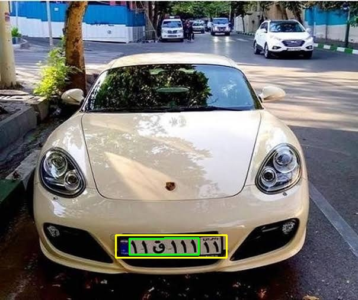
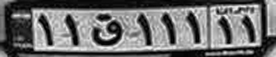

# 🔍 License Plate Detection & OCR

  

A Python project that combines **license plate localization** with **optical character recognition (OCR)**. OpenCV is used to find a likely plate region in a car image, while EasyOCR attempts to read the cropped text in English or Persian.

The goal is to explore how classical image processing and OCR can work together in a small, understandable pipeline.

## ✨ Pipeline

1. **Preprocessing:** Convert the input to grayscale and apply bilateral filtering.
2. **Edge detection:** Use Canny to identify strong edges.
3. **Plate localization:** Search for four-sided contours with a plausible license-plate aspect ratio.
4. **Cropping:** Extract the selected region with extra padding where needed.
5. **OCR preparation:** Enlarge the crop and enhance local contrast with CLAHE.
6. **Text recognition:** Run EasyOCR and filter out very low-confidence results.
7. **Save results:** Export the annotated image, cropped plate, processed OCR image, and recognized text when available.

## 🖼️ Example results

| Detected plate region | Preprocessed OCR input |
| --- | --- |
|  |  |

## 📂 Project structure

```text
├── LicensePlateDetection.py
├── images/
│   ├── car_plate1.jpg
│   ├── car_plate2.jpg
│   ├── car_plate3.jpg
│   └── car_plate4.jpg
└── results/
    ├── plate_detected.jpg
    ├── plate_crop.jpg
    └── plate_ocr_input.jpg
```

The script also writes `results/recognized_text.txt` after a successful plate-localization step.

## ⚙️ Run locally

```bash
git clone https://github.com/YasiNoshirvan/License-Plate-Detection-by-Image-Processing.git
cd License-Plate-Detection-by-Image-Processing
pip install numpy opencv-python matplotlib imutils easyocr
```

**One path adjustment:** The uploaded script currently points to a local Windows image folder. Replace its `image_path` line with:

```python
image_path = project_dir / 'images' / image_name
```

Choose the sample image and OCR language near the top of `LicensePlateDetection.py`:

```python
plate_language = 'fa'       # 'fa' or 'en'
image_name = 'car_plate3.jpg'
```

Then run:

```bash
python LicensePlateDetection.py
```

EasyOCR runs on the **CPU** in this script. On the first run, it may download the required recognition models.

## ⚠️ Limitations

The contour-based detector may select the wrong rectangle or fail on challenging images. **Persian plate recognition is experimental** and can be unreliable on small or low-quality crops. The confidence filter reduces some uncertain outputs but does not guarantee that the remaining text is correct. No accuracy benchmark is claimed.

---

*An educational project combining classical computer vision with English/Persian OCR.*
